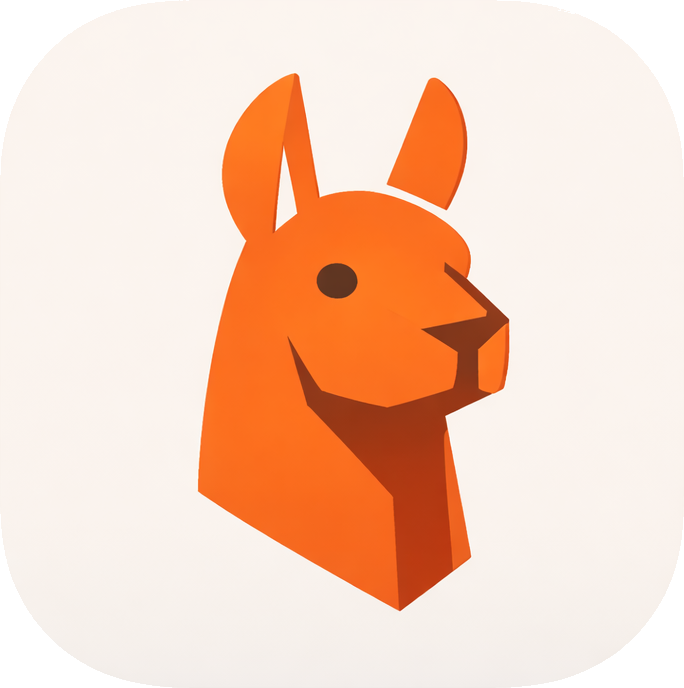

<p align="center">
  
</p>

<h1 align="center">Llamatik Coding Agent</h1>

<p align="center">
  <b>A coding agent that runs on local models and Llamatik servers — as libraries, a terminal app and an editor agent.</b>
</p>

<p align="center">
  Local by default · Privacy-preserving · Plain JDK, no IDE dependency
</p>

<p align="center">
  <a href="https://central.sonatype.com/artifact/com.llamatik/agent-core"></a>
  
  
  
  
  
  <a href="https://plugins.jetbrains.com/plugin/31304"></a>
</p>

---

## ✨ What is the Llamatik Coding Agent?

The agent behind [Llamatik Code](https://plugins.jetbrains.com/plugin/31304), extracted so it can run anywhere: in your terminal, in any editor that speaks the Agent Client Protocol, or embedded in your own app.

- 🤖 **Agent loop** — prompts, tool calling, proposal validation and host abstractions in `agent-core`
- 🔒 **Privacy-first** — runs a local GGUF model in-process, or talks to a [Llamatik Server](https://github.com/ferranpons/Llamatik-Server)
- 🖥 **Terminal agent** — `llamatik`, with diff previews and approval before every edit or command
- 🔌 **ACP agent** — `llamatik-acp` for Zed, JetBrains, Neovim and other ACP clients
- 📡 **Network discovery** — find Llamatik servers on your LAN, with resumable streaming

---

## 🧱 Modules

| Module | What it is | Distributed as |
|---|---|---|
| `agent-core` | The agent: loop, prompts, tools, host abstractions. No IDE dependency. | `com.llamatik:agent-core` |
| `backends` | Local llama.cpp engine, Llamatik server client (resumable streaming), network discovery. Plain JDK code. | `com.llamatik:agent-backends` |
| `cli` | `llamatik`: terminal agent. | distribution archive |
| `acp` | `llamatik-acp`: Agent Client Protocol agent over stdio (Zed, JetBrains, Neovim, ...). | distribution archive |

`agent-core` and `backends` must stay free of `com.intellij` and of coroutines/ktor/serialization (they run inside
IDE plugins whose classloaders ship older copies of those). See [docs/agent-core-extraction.md](docs/agent-core-extraction.md) for the design and [docs/command-line-and-acp.md](docs/command-line-and-acp.md) for the CLI and ACP guide.

---

## 🔧 Build

```bash
./gradlew build            # compile and test everything
./gradlew :cli:installDist # cli/build/install/llamatik/bin/llamatik
./gradlew :acp:installDist # acp/build/install/llamatik-acp/bin/llamatik-acp
```

---

## ⚡ Quick Start

```bash
# Local GGUF model, in-process
cli/build/install/llamatik/bin/llamatik --model /path/to/model.gguf

# A Llamatik server (e.g. the Llamatik app with "Share this device")
cli/build/install/llamatik/bin/llamatik --server 192.168.1.20

# Scan the local network and pick a server
cli/build/install/llamatik/bin/llamatik --discover

# One-shot prompt
cli/build/install/llamatik/bin/llamatik -m model.gguf -p "Explain this project"
```

For editors, point your ACP client at `acp/build/install/llamatik-acp/bin/llamatik-acp` (same `--model` / `--server` options).

### Settings file

Like Claude Code, the CLI reads JSON settings files; later ones win, and command-line flags win over all of them:

| File | Purpose |
|---|---|
| `~/.llamatik/settings.json` | your defaults for every project |
| `<project>/.llamatik/settings.json` | shared with the project (commit it) |
| `<project>/.llamatik/settings.local.json` | yours, for this project only (keep it out of git) |
| `--config <file>` | one more file, read last |

`//` and `#` comments are allowed. Type `/config` in a session to see what is in effect.

```jsonc
{
  "model": "~/.llamatik/models/Qwen3-14B-Q8_0.gguf",   // or "server": "192.168.1.20" (not both)
  "inference": {                // the options of the Llamatik app
    "temperature": 0.7,         // 0 - 2
    "maxTokens": 8192,          // largest reply
    "contextSize": 16384,       // context window in tokens: raise it if the agent runs out of room
    "batchSize": 2048,
    "topP": 0.95,
    "topK": 40,
    "repeatPenalty": 1.1,
    "threads": 8,
    "gpuLayers": -1,            // 0 = CPU only, -1 = all layers
    "flashAttention": false,
    "useMmap": true
  },
  "agent": {                    // how the agent loop budgets its work
    "maxSteps": 30,             // model calls per task
    "maxToolCallsPerStep": 3,   // tool calls run per reply
    "temperature": 0.3,         // sampling temperature is capped to this while the agent works
    "charsPerToken": 2.5,       // lower = more cautious prompt sizing (source code is ~2.5-3)
    "maxResultChars": 16000,    // largest tool result sent to the model
    "outputReserveShare": 0.25, // share of the context kept free for the reply
    "thinking": false           // let reasoning models think before each reply (slower)
  },
  "auto": {                     // tuning to this machine (on by default); "auto": false turns it off
    "maxContext": 32768,        // never pick more context than this
    "memoryBudgetMB": 24000     // memory the model may use, if the detected one is wrong for you
  },
  "permissions": { "autoApprove": false }
}
```

### Tuning to your machine

You normally do not need to set `contextSize`, `threads`, `batchSize`, `gpuLayers` or `flashAttention`. With a local model the CLI reads the machine (RAM, the GPU memory macOS allows, performance cores) and the model file itself (its size, layers, KV heads, trained context) and chooses values that fit. For example, Qwen3-14B Q8 on a 32 GB M1 Pro gets a 19K context with flash attention and all layers on the GPU, because the weights (14.6 GB) plus two contexts of cache and buffers must stay inside the ~24 GB the GPU may use. A 1B model on the same machine gets its full 32K.

Anything you set in a settings file or as a flag wins over the tuned value. `/config` shows what was chosen and why; `--no-auto` or `"auto": false` turns it off. It does not run for `--server`, where the server decides.

If the agent forgets what it read, lower `agent.maxResultChars` or raise `auto.maxContext` / `inference.contextSize` (the model must support it and the memory must be there; a value that is too large fails with a GPU out-of-memory error).

---

## 📦 Use the libraries

```kotlin
dependencies {
    implementation("com.llamatik:agent-core:<version>")
    implementation("com.llamatik:agent-backends:<version>")
}
```

Try an unreleased build locally with `./gradlew publishToMavenLocal -PreleaseVersion=0.1.0-local` and add
`mavenLocal()` to the consumer.

---

## 🚀 Release

Publishing a GitHub release tagged `vX.Y.Z` runs `.github/workflows/publish-mavencentral.yml`: it tests, signs and
publishes `agent-core` and `agent-backends` as `X.Y.Z` to Maven Central (same `com.llamatik` namespace and
secrets as the Llamatik library: `MAVEN_CENTRAL_USERNAME`, `MAVEN_CENTRAL_PASSWORD`, `SIGNING_KEY`,
`SIGNING_PASSWORD`). Locally: `./gradlew publishToSonatype closeAndReleaseSonatypeStagingRepository` with the same
values as environment variables and `RELEASE_VERSION` set.

---

## 📜 License

This project is released under the [MIT License](./LICENSE). The **Llamatik name and logo are proprietary marks** owned by Ferran Pons and are not covered by the MIT License.

---

Built with ❤️ for the Kotlin community.
